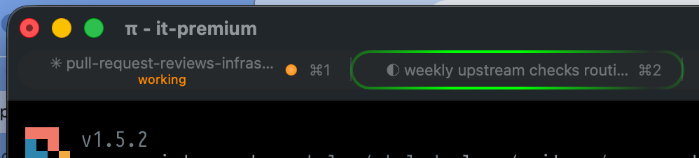

# pi-iterm2

Native **iTerm2** integration for the [Pi Coding Agent](https://github.com/earendil-works/pi-coding-agent).

Adds dynamic tab status indicators, dock/tab progress bars, and desktop notifications to Pi sessions running in iTerm2, matching the iTerm2 / Claude Code status conventions.



## Features

- **Tab Status Badges**:
  - 🟠 **Working**: Orange dot (`#ff9500`), status label `working`, and detail message with the active tool (`bash: git status`, `read: src/index.ts`, `edit: ...`).
  - 🔵 **Waiting**: Blue dot (`#5f87ff`), status label `waiting`, and detail message when waiting for user input or approval.
  - 🟢 **Idle**: Green dot (`#00d75f`), status label `idle` (dim gray `#888888`), and cleared detail text.
- **Dual-Layer Status Updates**:
  - Emits direct terminal control sequences (**OSC 21337**) with automatic tmux/screen passthrough.
  - Asynchronously updates iTerm2's session database via iTerm2's native CLI (`it2 session set-status`) targeting the exact session ID.
- **Dock & Tab Progress Bar**:
  - Indeterminate progress indicator while Pi is working (**OSC 9;4**).
  - Attention/error progress indicator when waiting for input.
  - Automatically cleared on turn completion.
- **Desktop Notifications**:
  - Native iTerm2 notifications (**OSC 9**) when a task finishes (>4s) or when user attention is required.
- **Commands**:
  - `/iterm2` — Inspect integration status.
  - `/iterm2 test` — Preview working, waiting, and idle status indicators in your tab bar.
  - `/iterm2 clear` — Clear all custom tab statuses.

## Installation

Install directly as a Pi package:

```bash
pi install git:github.com/mprokopov/pi-iterm2
```

Or clone into your local extensions directory:

```bash
git clone https://github.com/mprokopov/pi-iterm2.git ~/.pi/agent/extensions/pi-iterm2
```

Then reload Pi with `/reload` or restart your session.

## Requirements

- **iTerm2** 3.5 or later.
- Enable the Python API in iTerm2:
  `iTerm2 → Settings → General → Magic → Enable Python API`

## License

MIT © [Maksym Prokopov](https://github.com/mprokopov)
